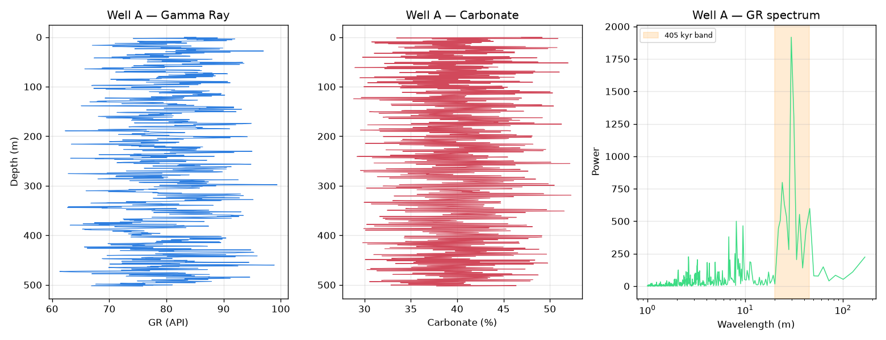

# CycloBench

[](https://github.com/KhanKehan/CycloBench/actions/workflows/ci.yml)
[](LICENSE)
[](pyproject.toml)
[](task.toml)

> **A reproducible, quantitatively-verifiable AI benchmark for astrochronology & cyclostratigraphy.**

**English** · [中文](README.zh-CN.md)

CycloBench evaluates whether a model or program can complete the **full cyclostratigraphic analysis chain**
on a lacustrine-basin record: *orbital signal detection → sedimentation-rate estimation → 405-kyr tuning →
hiatus identification → multi-proxy cross-validation → multi-well correlation*.
Each instance provides well-log data (gamma ray, carbonate content) and asks 8 numerically checkable questions.

The difficulty reflects the **real scientific bottlenecks** of continental records: weak orbital signal,
non-stationary sedimentation rate, multiple hiatuses and strong autogenic red noise. Any single shortcut
(default FFT confidence, a single global rate, ignoring hiatuses, single-proxy conclusions) fails at least one item.



---

## Task

- **Well A**: `Depth_m` / `GR_API` / `CARB_pct`
- **Well B**: `Depth_m` / `GR_API`
- Anchor: top of Well A (0 m) = **300.0 Ma**; age increases downward
- Output: `answers.json` (fixed fields) + process figures `figures/*.png`

| # | Content | Tolerance |
|---|---|---|
| Q1 | Total depositional duration (Myr) | ±0.10 |
| Q2 | Absolute age at 250 m (Ma) | ±0.050 |
| Q3 | All hiatuses (depth + missing time) | depth ±3 m; duration ±50 kyr |
| Q4 | Mean sedimentation rate (cm/kyr) | ±0.20 |
| Q5 | Dominant obliquity period (kyr, **needs age correction**) | ±2.0 |
| Q6 | Origin of ~60/~112 kyr peaks + CARB cross-check | all consistent |
| Q7 | ~170 kyr obliquity amplitude modulation | direction + range |
| Q8 | Regionally shared hiatus | depth ±3 m; duration ±50 kyr |

Scoring: 8 items × 0/1, `reward = correct / 8`.

---

## Data

Synthetic but scientifically grounded (not random noise):

- Orbital signal synthesized from the **300 Ma astronomical solution** (La2004 extrapolation + Waltham 2015):
  405/125/95 kyr eccentricity, 35 kyr obliquity (with ~170 kyr amplitude modulation), 21/18 kyr precession;
- Noise as **non-stationary AR(1) red noise** (ρ=0.92, σ=2.2→3.5);
- Two **autogenic quasi-periodic** components (~58–63 kyr, ~112–118 kyr);
- **Piecewise sedimentation rates** and **multiple hiatuses** (Well A: five; Well B: two, one shared);
- Resampled on a uniform 0.5 m step.

**8 seeds** (`seed_0..7`) with seed-varying ground truth to prevent answer memorization.
All data generated by the authors; free to use for training and evaluation.

See [`docs/任务说明.md`](docs/任务说明.md) for details.

---

## Repository structure

```
CycloBench/
├── README.md / README.zh-CN.md
├── LICENSE
├── instruction.md              # task statement (8 questions + output format)
├── task.toml                   # resource / timeout / network config
├── docs/任务说明.md            # background, generation, difficulty, rubric
├── data/seed_0..7/            # well_A.csv, well_B.csv (8 seeds)
├── tests/
│   ├── check_answers.py       # scoring (0/1 + tolerances)
│   ├── truths.json            # per-seed ground truth
│   └── test_cyclobench.py     # pytest suite
├── solution/
│   ├── solve.sh / solve.R     # R + astrochron reference solution
│   ├── verify_fairness.py
│   └── fairness_report.json
├── environment/Dockerfile     # R + astrochron environment
├── cyclobench/                # Python package (data loading + scoring)
└── pyproject.toml
```

---

## Quick start

```bash
pip install -e .
```

```python
import cyclobench as cb

cb.list_seeds()                        # [0, 1, ..., 7]
wa = cb.load_well(seed=0, well='A')    # pandas.DataFrame: Depth_m / GR_API / CARB_pct

res = cb.evaluate('answers.json', seed=0)
print(res['reward'], res['correct'], '/ 8')
```

CLI scoring:

```bash
python tests/check_answers.py answers.json tests/truths.json seed_0
```

Reference solution (R):

```bash
bash solution/solve.sh        # requires R 4.4+ and astrochron
```

---

## Evaluation & fairness

- Scoring reads only `answers.json`, isolated from the reference solution;
- The reference solution (`solution/solve.R`) is expected to reach full score;
- Every seed passes an **AR(1) red-noise Monte-Carlo test**: 405 kyr, ~60 kyr and ~112 kyr signals are
  significant above the 95% confidence line, while CARB is insignificant in the 57–63 / 108–118 kyr bands
  (making Q6 decidable). See `solution/fairness_report.json`.

---

## Citation

```bibtex
@misc{cyclobench2026,
  title  = {CycloBench: A Reproducible Benchmark for Cyclostratigraphic Analysis},
  author = {Yu, Kehan},
  year   = {2026},
  note   = {https://github.com/KhanKehan/CycloBench}
}
```

## License

Code and data released under the **MIT License** — see [`LICENSE`](LICENSE).
